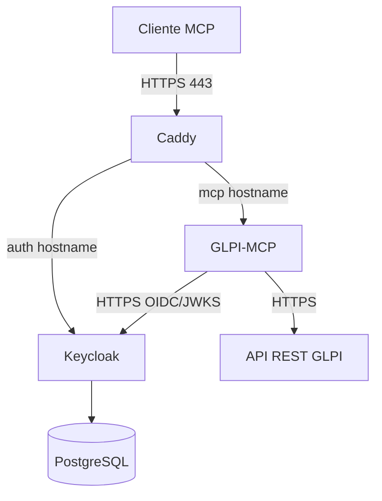
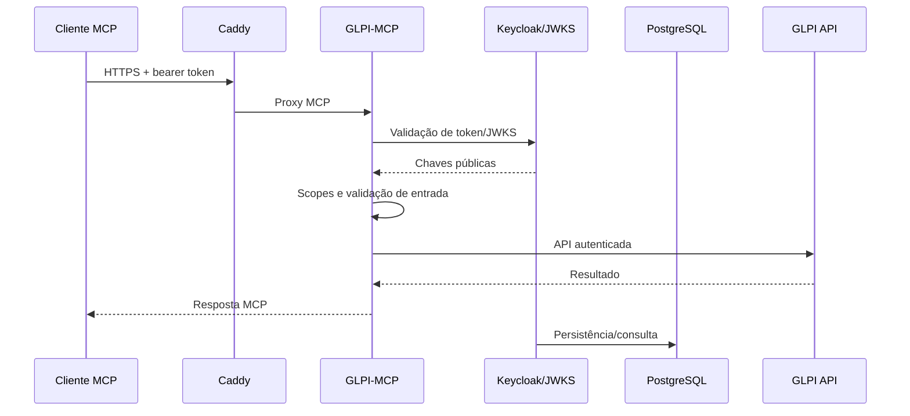

# Arquitetura

## Visão geral

GLPI-MCP é um servidor MCP em Python que conecta clientes compatíveis à API REST legada do GLPI. O protocolo MCP fornece a interface de ferramentas; a integração GLPI executa chamadas autenticadas à API.

## Componentes

- **Cliente MCP:** interface de IA ou aplicação que solicita execução de ferramentas.
- **GLPI-MCP:** servidor FastMCP, valida parâmetros, tokens e scopes, e registra ferramentas.
- **Autorização:** validação de scopes `glpi:read` e `glpi:write`.
- **Keycloak/OIDC:** provedor de identidade que emite access tokens.
- **PostgreSQL:** persistência do Keycloak.
- **Caddy:** proxy reverso e terminação TLS.
- **GLPI:** sistema ITSM com API REST legada.
- **Docker Compose:** orquestra os serviços de implantação remota.

## Execução local

No modo `stdio`, o cliente MCP inicia GLPI-MCP localmente. A autenticação OIDC remota é desabilitada nesse cenário.

No modo `streamable-http` local, o servidor atende em loopback, normalmente `127.0.0.1:8000/mcp`, indicado para desenvolvimento e testes.

## Implantação remota com Compose

O Compose principal inclui Keycloak, PostgreSQL, GLPI-MCP e Caddy. O Keycloak emite tokens; GLPI-MCP valida assinatura, issuer, audience, expiração e scopes.

O Caddy publica os hosts MCP e identidade. GLPI-MCP e Keycloak não publicam portas no host. PostgreSQL é conectado somente à rede interna de identidade. Keycloak compartilha a rede do proxy para receber encaminhamento HTTPS e também participa da rede interna do banco. GLPI-MCP mantém sua rede de saída para acessar GLPI e endpoints OIDC.

## Autenticação e autorização

1. Cliente obtém access token via provedor OIDC.
2. Cliente envia bearer token às requisições MCP.
3. GLPI-MCP valida o JWT usando JWKS.
4. A validação exige issuer, audience, expiração e assinatura válida.
5. Consultas exigem scope de leitura.
6. Escritas exigem scopes de leitura e escrita.
7. Conta técnica GLPI tem suas próprias permissões mínimas.

Scopes OAuth não substituem autorização GLPI.

## Fluxo de ferramenta

## Redes e exposição

- Caddy publica 80/TCP, 443/TCP e 443/UDP opcional.
- GLPI-MCP atende internamente na porta 8000.
- Keycloak atende internamente na porta 8080.
- PostgreSQL atende internamente na porta 5432.
- Portas MCP, Keycloak e banco não são publicadas no host.
- MCP usa rede de saída para GLPI e endpoints de identidade.

## Componentes do código

- `core/config.py`: configurações.
- `core/oauth.py`: validação JWT/OIDC.
- `core/authorization.py`: scopes.
- `core/registry.py`: servidor e ferramentas.
- `integrations/glpi/client.py`: API REST GLPI.
- `integrations/glpi/tools.py`: ferramentas e validação.
- `server.py`: inicialização.

## Referências

- [README](../README.md)
- [Implantação](DEPLOYMENT.md)
- [Keycloak](KEYCLOAK.md)
- [Segurança](SECURITY.md)
