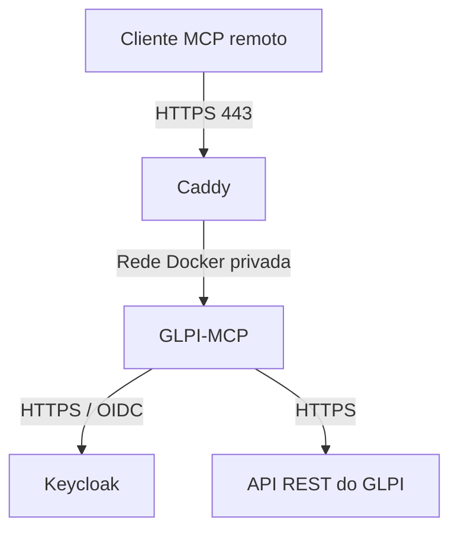
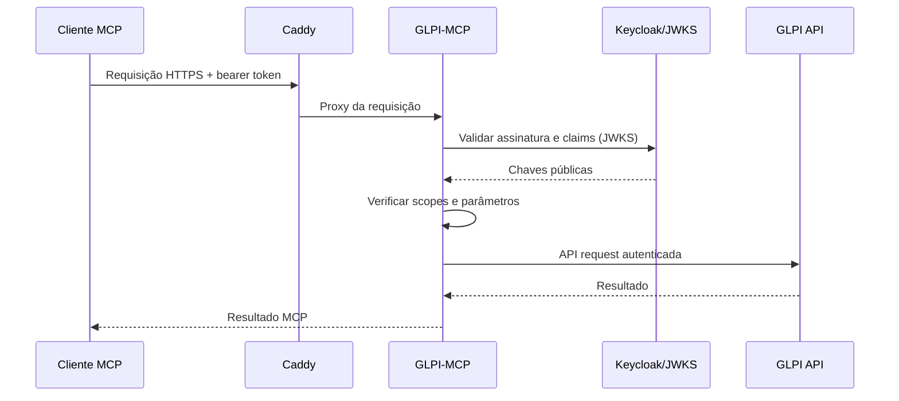

# Arquitetura

## Visão geral

O GLPI-MCP é um servidor MCP em Python que conecta clientes compatíveis à API REST legada do GLPI. O protocolo MCP fornece a interface de ferramentas; a integração GLPI executa chamadas autenticadas à API.

## Componentes

- **Cliente MCP:** interface de IA ou aplicação que solicita execução de ferramentas.
- **GLPI-MCP:** servidor FastMCP, valida parâmetros, tokens e scopes, e registra ferramentas.
- **Autorização:** validação de scopes `glpi:read` e `glpi:write`.
- **Keycloak/OIDC:** provedor externo de identidade que emite access tokens.
- **Caddy:** proxy reverso e terminação TLS na implantação remota.
- **GLPI:** sistema de ITSM que fornece a API REST legada.
- **Docker Compose:** isolamento e orquestração dos serviços remotos.

## Execução local

No modo `stdio`, o cliente MCP inicia o processo GLPI-MCP localmente e comunica-se pelo standard input/output. A autenticação remota OIDC é desabilitada nesse cenário.

No modo `streamable-http` local, o servidor atende em endereço loopback, normalmente `127.0.0.1:8000/mcp`. Esse modo é indicado para desenvolvimento e testes locais.

## Execução remota

A implantação remota deve publicar somente o proxy HTTPS. O serviço GLPI-MCP permanece sem porta publicada diretamente no host.

O Keycloak é um provedor OIDC separado da aplicação MCP. Ele emite tokens, enquanto GLPI-MCP atua como resource server: valida assinatura, emissor, audience, expiração e scopes. GLPI-MCP não cria sessões de login nem emite tokens.

## Autenticação e autorização

1. O cliente obtém um access token com o provedor OIDC configurado.
2. O cliente envia o token como bearer token nas requisições MCP.
3. GLPI-MCP valida o token com as chaves publicadas no JWKS.
4. A validação exige issuer, audience e expiração e aceita algoritmos de assinatura configurados.
5. As ferramentas de consulta exigem o scope de leitura.
6. As ferramentas de escrita exigem leitura e escrita.
7. O cliente GLPI usa as credenciais de uma conta técnica separada para acessar a API.

Os scopes OAuth não substituem as permissões da conta técnica dentro do GLPI. As duas camadas de autorização devem ser configuradas com privilégio mínimo.

## Fluxo de chamada de ferramenta

## Componentes de código

- `core/config.py`: leitura e validação das configurações.
- `core/oauth.py`: validação de tokens OIDC/JWT e claims.
- `core/authorization.py`: requisitos de scopes.
- `core/registry.py`: criação e configuração do servidor MCP.
- `integrations/glpi/client.py`: comunicação com a API REST GLPI.
- `integrations/glpi/tools.py`: ferramentas e validação de operações.
- `server.py`: entry point e registro de ferramentas.

## Redes e exposição

No Compose de referência, Caddy publica TCP 80 e 443 (UDP 443 opcional). O GLPI-MCP expõe internamente a porta 8000 na rede Docker e não publica essa porta no host. O proxy e o servidor comunicam-se pela rede privada Docker. O serviço MCP precisa de saída para alcançar o GLPI e os endpoints de identidade.

## Referências

- [README](../README.md)
- [Implantação](DEPLOYMENT.md)
- [Configuração do Keycloak](KEYCLOAK.md)
- [Segurança](SECURITY.md)
